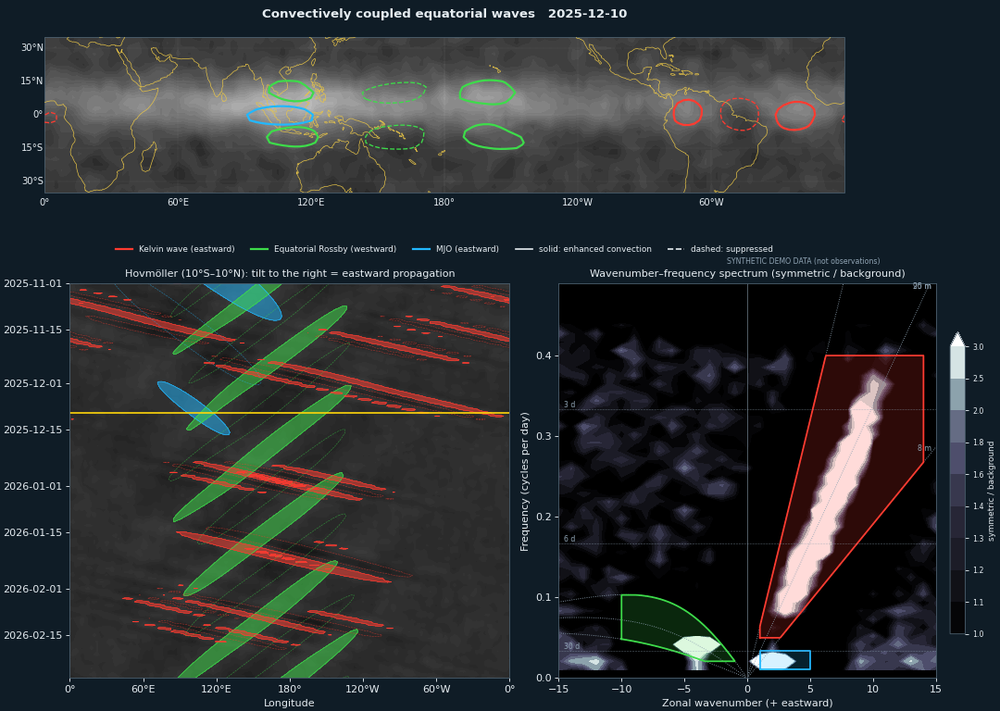

# tropical-waves-viz

热带对流耦合赤道波动（Kelvin 波 / MJO / 赤道 Rossby 波）的交互式可视化网页。用公开的卫星资料，在一个页面里同时看地图、Hovmöller 图、波数-频率谱和单点时间序列，所有参数都能在侧栏里调整，并可以导出 GIF / MP4 动画用于汇报。



*上图为合成演示数据，仅示意界面效果。*

## 功能

- **四个联动面板**，共用一个日期滑块：
  - 地图：云或降水背景 + 各波动的滤波等值线；带状全球或地球仪两种投影。
  - Hovmöller 图：经度 × 时间，传播方向和速度一目了然；有填色、阴影、线条三种样式。
  - 波数-频率谱：Wheeler–Kiladis 谱、理论频散曲线、各波动的滤波区域。调参数时，滤波框会实时变化。
  - 单点时间序列：任选经度，比较各波动的周期。
- **可调参数**：
  - 时间段、数据源。
  - 每种波动的开关、颜色、阈值，以及周期 / 波数 / 等效深度滤波范围。
  - 投影、背景场与配色、Hovmöller 样式、主题（深色/浅色）、图中文字（英文/中文）、字体、标题、分辨率、帧率。
- **背景可选**：OLR（无需账号），或 NASA Earthdata 的 4 km 红外亮温（GPM_MERGIR）、IMERG 逐日降水。
- **配置可存取**：网页里的设置可以导出成 JSON，下次载入，或交给命令行批量出高清动画。

## 快速开始

```bash
git clone https://github.com/Blissful-Jasper/tropical-waves-viz.git
cd tropical-waves-viz
conda create -n twv python=3.11 -y && conda activate twv
pip install -r requirements.txt          # cartopy 也可以用 conda install -c conda-forge cartopy
streamlit run app.py
```

浏览器会自动打开 http://localhost:8501 。第一次可以先在侧栏“数据与时间”里选 **合成演示数据**，不联网也能熟悉界面。

## 数据

| 用途 | 数据 | 获取方式 |
|---|---|---|
| 波动滤波，2024 年至今 | NOAA OLR Climate Data Record v02r00，逐日 1°，约 2 天延迟 | 自动下载年度文件到 `data/olr_cache/` |
| 波动滤波，1974-06 ~ 2022-12 | NOAA PSL 插值 OLR（2.5°，Liebmann & Smith 1996） | 本地文件 → 本仓库 Release 年度小文件 → NCEI → PSL OPeNDAP |
| 2023 年 | 只有 OLR CDR 提供（PSL 已停更） | 从 http://olr.umd.edu/ 下载 CDR 文件放入缓存目录 |
| 背景：红外亮温 | NCEP/CPC GPM_MERGIR，4 km，逐半小时 | NASA Earthdata（免费账号） |
| 背景：降水 | GPM IMERG V07 逐日（Final 约 3.5 个月延迟；Late 约 1–2 天） | NASA Earthdata（免费账号） |

数据源默认为 **自动**：先在 OLR 缓存目录（侧栏可改，默认 `data/olr_cache/`）里找文件。目录里的任何 `.nc` 都会按**文件内的时间范围**自动识别，文件名不限，例如 PSL 的 `olr.day.mean.nc` 或 CDR 年度文件。缺少的年份才会在线获取。一个文件能覆盖整个时段时只用它；需要跨数据源拼接时（例如 2022 + 2024），会统一插值到 2.5° 网格，并给出提示。

本地已有大文件时，不用复制进仓库，用环境变量追加目录即可：

```bash
export TWV_OLR_DIRS=/Users/you/Desktop/2026-tropicalcool/olr_cache   # 多个目录用 : 分隔
streamlit run app.py
```

### 把 2024 年以前的数据放到线上（GitHub 不能直接放 350 MB 文件）

GitHub 仓库单个文件不能超过 100 MB，而且大文件会让每次克隆都变慢。所以按年切成小文件（±62°、int16 压缩，约 3 MB/年，1974–2022 共约 150 MB），放进 GitHub Release。部署好的网页只下载用到的那几年。

```bash
python scripts/make_olr_subsets.py /path/to/olr.day.mean.nc --out release_data
gh release create olr-data-v1 release_data/*.nc --title "OLR yearly subsets (PSL interpolated OLR)" \
   --notes "NOAA PSL interpolated OLR, 1974-06 ~ 2022-12, 2.5°, ±62°, int16 (0.1 W m-2)"
```

Release 地址由 `Config.data_release` 指定，默认指向本仓库的 `olr-data-v1`。

**OLR 自动下载失败时**：用浏览器打开 http://olr.umd.edu/ ，在 Daily Mean OLR 的 Data access 里下载所需年份的文件，放进缓存目录即可。

**使用 Earthdata 背景**：
1. 在 https://urs.earthdata.nasa.gov 注册。
2. 在 Profile → EULAs → Accept New EULAs 中，接受 **NASA GESDISC DATA ARCHIVE**。
3. 在 Applications → Authorized Apps 中，授权同名应用。操作时请关闭浏览器的网页翻译。
4. 在网页侧栏填写账号密码，或在 `~/.netrc` 中配置 `machine urs.earthdata.nasa.gov`。

背景按帧下载，处理成小缓存后删除原始文件，再次使用不会重复下载。

## 命令行

与网页共用同一套参数，适合出高分辨率动画：

```bash
python cli.py --source demo --out demo.gif
python cli.py --start 2025-11-01 --end 2026-02-28 --bg mergir --out talk.mp4
python cli.py --config tropical_waves_config.json --set dpi=150 --out talk_hd.gif
python cli.py --set waves.kelvin.enabled=false --set hov_style=shaded --print-config
```

`--set` 可以修改任何参数，参数名见 [`tropical_waves/config.py`](tropical_waves/config.py)。

## 部署

- **Streamlit Community Cloud（免费）**：把仓库推到 GitHub，在 https://share.streamlit.io 选择仓库和 `app.py` 即可。`packages.txt` 会自动安装 ffmpeg。免费实例内存有限，建议展示时段不超过 4–6 个月；MERGIR 背景较耗资源。
- **Docker**：
  ```bash
  docker build -t tropical-waves-viz .
  docker run -p 8501:8501 -v $PWD/data:/app/data tropical-waves-viz
  ```

## 项目结构

```
app.py                     网页（Streamlit）
cli.py                     命令行
tropical_waves/
  config.py                全部参数（Config）与默认滤波设置
  filters.py               波数-频率滤波、频散关系、Wheeler–Kiladis 谱
  data.py                  OLR 下载/读取/缓存（本地文件自动识别、跨数据源拼接）、合成演示数据
  background.py            Earthdata 背景（MERGIR / IMERG）
  plots.py                 地图、Hovmöller、谱、时间序列、动画导出
scripts/make_olr_subsets.py  把大 OLR 文件切成按年的小文件（上传到 GitHub Release）
tests/                     单元测试与冒烟测试（GitHub Actions 自动运行）
```

## 方法说明

对热带 OLR 做二维（时间 × 经度）傅里叶变换，在频率-波数平面上只保留某种波动所在的区域，再反变换回来。默认参数如下：

| 波动 | 波数 | 周期 | 等效深度 |
|---|---|---|---|
| Kelvin | 1 – 14（东传） | 2.5 – 20 天 | 8 – 90 m |
| MJO | 1 – 5（东传） | 30 – 96 天 | — |
| 赤道 Rossby（n=1） | −10 – −1（西传） | 9.7 – 48 天 | 8 – 90 m |

### 为什么 Kelvin 波的等值线常常比 MJO 还大？

这主要不是绘图错误，而是滤波频段和阈值共同造成的。用 2014–2019 年 PSL OLR 实测各波动滤波后的标准差（W m⁻²）：

| 纬度 | 0° | 10° | 20° | 25–30° |
|---|---|---|---|---|
| Kelvin | 10.1 | 7.7–10.4 | 8.0–9.1 | 9–12.6 |
| MJO | 7.3 | 7.2–8.2 | 5.3–5.7 | 4.5–5.1 |
| ER | 6.7 | 7.9–9.2 | 6.2–7.8 | 4.5–6.3 |

1. **Kelvin 频段本身方差更大**。Kelvin 滤波窗口覆盖波数 1–14、周期 2.5–20 天，在谱上面积远大于 MJO 的窗口（波数 1–5、周期 30–96 天），收进的 OLR 方差更多（其中也包括一部分红噪声背景）。逐日 OLR 中 Kelvin 波本来就是方差最大的对流耦合波之一（Kiladis et al. 2009）。两者用同一个绝对阈值（如都取 −10 W m⁻²）时，Kelvin 越过阈值的面积自然更大。MJO 的特点是尺度大、持续久，而不是逐日振幅大。
2. **中纬度信号漏入**。在 20–30° 纬度，东传、2.5–20 天的频段会收进中纬度斜压天气扰动，那里“Kelvin 滤波”的方差甚至比赤道还大。这部分信号不是 Kelvin 波。

现在的处理：

- 每种波动有自己的等值线纬度范围 `lat_max`（Kelvin ±15°，MJO ±20°，ER ±25°）。
- 可选“对称分量滤波”：先取 (OLR(φ)+OLR(−φ))/2 再滤波（Wheeler & Kiladis 1999），进一步压制中纬度信号。代价是图会关于赤道对称。
- 阈值可以按“各自标准差的倍数（σ）”设定，使不同波动在自身强度的同一水平画线，比较起来更公平。网页会显示当前时段各波动在 10°S–10°N 的 σ。
- MJO 默认阈值改为 8 W m⁻²。

注意事项：
- 滤波需要比显示时段更长的序列。程序默认前后各加 180 天缓冲。
- 显示时段的结束日期最好比数据末端早约 90 天，否则末端几帧（尤其 MJO）会失真。
- 滤波结果是“落在某个频率-波数范围内的信号”，并不保证每一处都是严格意义上的单一波动。解读时可以结合波数-频率谱面板。

## 参考文献与数据引用

- Wheeler, M., and G. N. Kiladis, 1999: Convectively coupled equatorial waves: Analysis of clouds and temperature in the wavenumber–frequency domain. *J. Atmos. Sci.*, 56, 374–399.
- Kiladis, G. N., M. C. Wheeler, P. T. Haertel, K. H. Straub, and P. E. Roundy, 2009: Convectively coupled equatorial waves. *Rev. Geophys.*, 47, RG2003.
- Lee, H.-T., 2025: NOAA Climate Data Record (CDR) of Daily Outgoing Longwave Radiation (OLR), Version 2.0. NOAA NCEI, doi:10.25921/9pt5-by77.
- Janowiak, J., B. Joyce, and P. Xie, 2017: NCEP/CPC L3 Half Hourly 4km Global (60S–60N) Merged IR V1 (GPM_MERGIR), GES DISC.
- Huffman, G. J., et al.: GPM IMERG Final/Late Precipitation L3 1 day 0.1° V07, GES DISC.

## 许可

MIT
